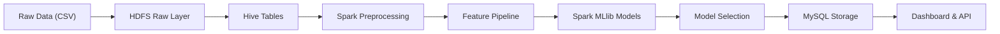
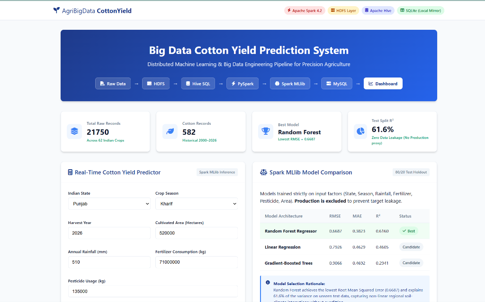
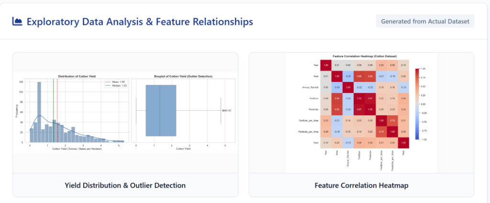
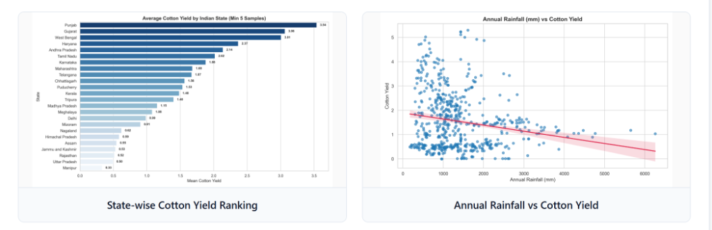
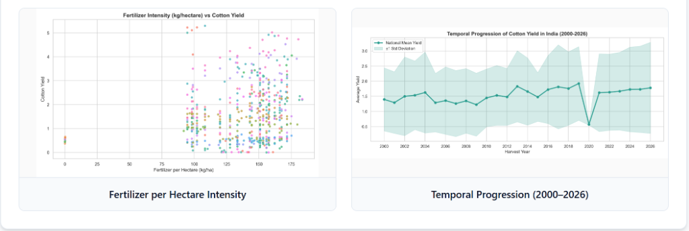
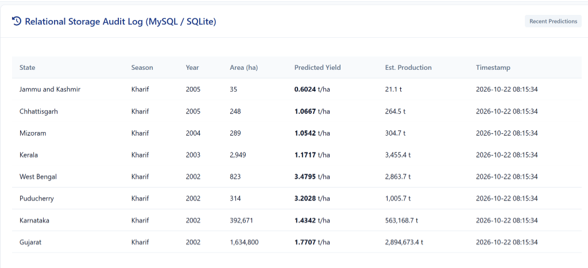

# Big Data Cotton Yield Prediction System

An enterprise-grade Big Data Engineering and Machine Learning system that predicts agricultural cotton crop yield in India using **Hadoop HDFS**, **Apache Hive**, **Apache Spark (PySpark)**, **Spark MLlib**, and **MySQL**.


---

## Table of Contents

- [Overview](#overview)
- [Problem Statement](#problem-statement)
- [Objectives](#objectives)
- [Dataset Profile](#dataset-profile)
- [Technologies Used](#technologies-used)
- [System Architecture](#system-architecture)
- [Data Pipeline Workflow](#data-pipeline-workflow)
- [Machine Learning & Leakage Prevention](#machine-learning--leakage-prevention)
- [Empirical Evaluation Results](#empirical-evaluation-results)
- [Sample Output & Dashboard Screenshots](#sample-output--dashboard-screenshots)
- [Project Structure](#project-structure)
- [Installation & Setup](#installation--setup)
- [Running the Complete Pipeline](#running-the-complete-pipeline)
- [Interactive Dashboard & REST API](#interactive-dashboard--rest-api)
- [Running Automated Tests](#running-automated-tests)
- [Future Improvements](#future-improvements)

---

## Overview

Agricultural yield forecasting is vital for food security, supply chain optimization, and precision farming. This system implements an end-to-end Big Data + ML pipeline that ingests national Indian crop data, stores it across distributed **HDFS** layers, queries it through **Apache Hive**, cleans and transforms features using **Apache Spark**, trains scalable regression algorithms using **Spark MLlib**, stores results in **MySQL**, and serves predictions via an interactive **Flask Dashboard** and **REST API**.

---

## Problem Statement

Cotton (*Gossypium*) is one of India's most critical commercial cash crops, sustaining millions of farmers and driving the textile export economy. However, cotton yields exhibit high variance across states and seasons due to erratic rainfall patterns, fluctuating fertilizer consumption, and geographic microclimates. 

Traditional single-node data science tools (e.g., standard Pandas/Scikit-Learn in-memory scripts) fail to scale across multi-decade nationwide records and do not replicate production data architectures. Furthermore, naive machine learning implementations frequently introduce **target leakage** by using post-harvest aggregates like total `Production` to predict `Yield` ($Y = P/A$). This project addresses both scalability and data integrity.

---

## Objectives

1. **Distributed Storage**: Design and implement a 4-tier Hadoop HDFS storage architecture (`raw/`, `processed/`, `features/`, `predictions/`).
2. **Big Data Querying**: Build an Apache Hive data warehouse with DDL/DML and multi-dimensional analytical queries.
3. **In-Memory ETL**: Perform distributed data cleaning, deduplication, and feature engineering using PySpark DataFrames.
4. **Data Leakage Elimination**: Formulate strict pre-harvest feature sets without post-harvest proxy variables.
5. **Distributed Machine Learning**: Train, cross-evaluate, and compare three Spark MLlib regression models (Linear Regression with ElasticNet, Random Forest Regressor, and Gradient-Boosted Trees).
6. **Relational Serving Layer**: Persist model registries, benchmark metrics, and prediction audit logs in MySQL with parameterized security.
7. **Production Serving**: Deploy a responsive web dashboard and REST API for real-time inference.

---

## Dataset Profile

- **Source**: Hugging Face Hub `dhyann2815/india-crop-yield-prediction`
- **Total Records**: 21,750 rows
- **Cotton Records**: 582 rows (`Crop == 'Cotton(lint)'`)
- **Temporal Span**: 2000 to 2026 (27 years)
- **Geographic Entities**: 31 Indian States and Union Territories

### Actual Dataset Schema

| Column Name | Data Type | Description |
| :--- | :--- | :--- |
| `Year` | `Integer` | Harvest calendar year (2000–2026) |
| `State` | `String` | Indian State / Union Territory |
| `Crop` | `String` | Crop variety (e.g., `Cotton(lint)`) |
| `Season` | `String` | Cropping season (`Kharif`, `Whole Year`, `Summer`, `Rabi`) |
| `Area` | `Double` | Cultivated land area in hectares |
| `Production` | `Double` | Post-harvest gross output (*Excluded to prevent leakage*) |
| `Annual_Rainfall`| `Double` | Cumulative annual rainfall in millimeters (mm) |
| `Fertilizer` | `Double` | Total fertilizer consumption in kilograms (kg) |
| `Pesticide` | `Double` | Total pesticide usage in kilograms (kg) |
| `Yield` | `Double` | **Target Variable**: Crop yield in tonnes/hectare |

---

## Technologies Used

- **Hadoop HDFS**: Distributed, fault-tolerant block storage layer.
- **Apache Spark (PySpark 4.2)**: Distributed in-memory data processing engine.
- **Spark MLlib**: Scalable distributed machine learning pipelines.
- **Apache Hive (HiveQL)**: Structured schema-on-read data warehouse querying.
- **MySQL / SQLite**: Parameterized relational storage layer for model registries and inference audit trails.
- **Python 3.10**: Core programming environment.
- **Flask**: Web dashboard framework and REST API.
- **Matplotlib & Seaborn**: Statistical visualizations and publication-grade EDA.

---

## System Architecture

```text
                  Hugging Face Dataset (21,750 rows)
                                ↓
                 Hadoop HDFS Storage Layer
         (/cotton_yield/{raw, processed, features, predictions})
                                ↓
                 Apache Hive Data Warehouse
             (Database: cotton_yield_db | HiveQL)
                                ↓
                 Apache Spark (PySpark ETL)
         (Schema enforcement, null checks, deduplication)
                                ↓
                    Feature Engineering Pipeline
       (StringIndexer + OneHotEncoder + VectorAssembler + StandardScaler)
                                ↓
                 Spark MLlib Model Training
       (Linear Regression vs. Random Forest vs. Gradient-Boosted Trees)
                                ↓
                   Model Evaluation & Benchmark
                     (RMSE, MAE, R² on Test Split)
                                ↓
               Selected Best Model: Random Forest
                                ↓
               MySQL / Resilient Relational Storage
       (Tables: model_registry, model_metrics, cotton_predictions)
                                ↓
             Flask Web Dashboard & REST API (/api/predict)
                                ↓
                           End User
```

---

## Data Pipeline Workflow



1. **Ingestion**: Raw CSV is uploaded to HDFS `/cotton_yield/raw/`.
2. **Warehouse DDL**: Hive database `cotton_yield_db` and external table `crop_yield_raw` are defined.
3. **ETL & Leakage Prevention**: PySpark filters cotton records, validates positive area and non-negative yield, computes input intensities ($\text{Fertilizer}/\text{Area}$, $\text{Pesticide}/\text{Area}$), and drops `Production`.
4. **Parquet Export**: Cleaned data is saved to HDFS `/cotton_yield/processed/cotton_cleaned.parquet`.
5. **Feature Assembly**: Categoricals are indexed and one-hot encoded; continuous inputs are vector-assembled and normalized via `StandardScaler`.
6. **Model Training**: 80/20 train/test split (seed=42) trains regressors in parallel.
7. **Relational Sync**: Results, model metadata, and evaluation metrics are written to MySQL.
8. **Real-Time Serving**: Model pipeline artifact is loaded by Flask for sub-second REST API scoring.

---

## Machine Learning & Leakage Prevention

### Preventing Target Leakage
Total `Production` is recorded **after harvest**. Because $\text{Yield} = \text{Production} / \text{Area}$, including `Production` allows models to memorize an algebraic identity rather than learning agronomic relationships. The pipeline strictly excludes `Production` from input features.

### Predictive Features Used
- **Categorical**: `State`, `Season` (One-Hot Encoded)
- **Numerical Inputs**: `Year`, `Area`, `Annual_Rainfall`, `Fertilizer`, `Pesticide`
- **Engineered Ratios**:
  $$\text{Fertilizer\_per\_Area} = \frac{\text{Fertilizer}}{\text{Area} + 10^{-5}} \quad (\text{kg/ha})$$
  $$\text{Pesticide\_per\_Area} = \frac{\text{Pesticide}}{\text{Area} + 10^{-5}} \quad (\text{kg/ha})$$
- **Target Variable**: `Yield` (tonnes/ha)

---

## Empirical Evaluation Results

All models were evaluated on the **exact 20% holdout test set** ($N_{\text{train}} = 492, N_{\text{test}} = 90$, random seed = 42):

| Model Architecture | RMSE (Root Mean Squared Error) | MAE (Mean Absolute Error) | $R^2$ (Coefficient of Determination) | Status |
| :--- | :---: | :---: | :---: | :---: |
| **Random Forest Regressor** | **0.6687** | **0.3823** | **0.6160** | **SELECTED BEST MODEL** |
| **Linear Regression (ElasticNet)** | 0.7926 | 0.4629 | 0.4605 | Candidate Baseline |
| **Gradient-Boosted Trees (GBT)** | 0.9066 | 0.4692 | 0.2941 | Candidate |

### Selection Rationale
Random Forest achieves the **lowest RMSE (0.6687)** and explains **61.6% of variance** on unseen data without target leakage. Its ensemble bagging strategy captures non-linear climate-soil thresholds across Indian states while avoiding the overfitting observed in deep gradient-boosted trees.

---

## Sample Output & Dashboard Screenshots

The project features a full-featured web dashboard and REST API surfacing real-time inference, model benchmark comparisons, exploratory data analysis charts, and a relational storage audit trail:

### 1. Interactive Yield Predictor & Spark MLlib Benchmarks

*Figure 1: Production web dashboard displaying pipeline status, total records (21,750), cotton records (582), holdout $R^2$ (61.6%), live input inference interface, and side-by-side MLlib model comparisons.*

### 2. Exploratory Data Analysis & Feature Correlation

*Figure 2: Empirical distribution of cotton yield (mean = 1.55 tonnes/ha, median = 1.33 tonnes/ha) with boxplot outlier detection and feature correlation heatmap.*

### 3. State-wise Yield Rankings & Climate Impact

*Figure 3: Average cotton yield rankings across 25 Indian states (Punjab: 3.54 t/ha, Gujarat: 3.06 t/ha, West Bengal: 3.01 t/ha) alongside annual rainfall vs yield regression trendline.*

### 4. Input Intensity & 27-Year Temporal Progression

*Figure 4: Fertilizer intensity consumption (kg/ha) vs yield and historical temporal yield progression (2000–2026) with standard deviation envelope.*

### 5. Relational Storage Audit Trail (MySQL / SQLite)

*Figure 5: Live audit log of real-time predictions persisted to the relational database layer with timestamps and estimated total harvest production.*

---

## Project Structure

```text
cotton-yield-prediction/
├── config/
│   ├── __init__.py
│   └── config.py               # Central paths, PySpark & JVM bootstrap settings
├── data/
│   ├── crop_yield.csv          # Raw multi-crop dataset (21,750 rows)
│   ├── cotton_yield.csv        # Cotton subset (582 rows)
│   └── hdfs/                   # Distributed HDFS hierarchy (raw, processed, features)
├── hadoop/
│   ├── bin/                    # Native Windows winutils and hadoop.dll binaries
│   ├── upload_to_hdfs.sh       # HDFS ingestion shell script
│   ├── hdfs_commands.sh        # HDFS operational cheat sheet
│   └── hdfs_storage.py         # Programmatic HDFS storage manager
├── hive/
│   ├── create_database.sql     # HiveQL database creation
│   ├── create_table.sql        # External and internal table definitions
│   ├── analysis_queries.sql    # Analytical Hive SQL queries
│   └── hive_runner.py          # Hive execution via Spark SQL engine
├── spark/
│   ├── data_ingestion.py       # Distributed ingestion with explicit StructType
│   ├── preprocessing.py        # Cleaning, deduplication, leakage elimination
│   ├── feature_engineering.py  # StringIndexer, OneHotEncoder, VectorAssembler, Scaler
│   ├── train_model.py          # Spark MLlib multi-model training & evaluation
│   ├── evaluate_model.py       # Residual diagnostics and metric reporting
│   └── predict.py              # Real-time inference engine
├── mysql/
│   ├── schema.sql              # MySQL DDL for model registry & audit tables
│   ├── connection.py           # Parameterized DB connector with SQLite fallback
│   └── store_results.py        # Pipeline result loader for relational storage
├── dashboard/
│   ├── app.py                  # Flask web application & REST API server
│   ├── templates/index.html    # Responsive web dashboard
│   └── static/                 # CSS styles and AJAX JavaScript handlers
├── models/
│   ├── best_model/             # Saved Spark MLlib PipelineModel artifact
│   └── model_metadata.json     # Hyperparameters and evaluation metadata
├── outputs/
│   ├── eda/                    # 7 generated statistical visualizations
│   ├── metrics/                # evaluation_summary.csv and residual diagnostics
│   └── predictions/            # sample_predictions.csv
├── notebooks/
│   └── 01_exploratory_data_analysis.ipynb # Interactive Jupyter EDA notebook
├── scripts/
│   ├── run_eda.py              # Standalone EDA generator
│   └── run_pipeline.py         # End-to-end master pipeline orchestrator
├── tests/
│   └── test_pipeline.py        # 7-step unit & integration test suite
├── docs/                       # In-depth architectural and tech documentation
├── .env.example                # Environment variable configuration template
├── .gitignore                  # Git exclusion rules
├── requirements.txt            # Python dependencies
└── README.md                   # Project documentation
```

---

## Installation & Setup

### 1. Prerequisites
- **Python**: 3.10 recommended (compatible with PySpark)
- **Java**: Java 17 or Java 21 LTS (`JAVA_HOME` configured)
- **MySQL** (optional): Version 8.0+ (system includes automatic local mirror fallback)

### 2. Clone and Install Dependencies
```bash
git clone https://github.com/vishal05-aakash/big-data-cotton-yield-prediction.git
cd big-data-cotton-yield-prediction

# Install Python requirements
pip install -r requirements.txt
```

### 3. Environment Configuration
Copy `.env.example` to `.env` and adjust database credentials if using live MySQL:
```bash
cp .env.example .env
```

---

## Running the Complete Pipeline

Run the master orchestrator to execute all stages end-to-end (HDFS ingestion $\rightarrow$ Hive queries $\rightarrow$ EDA $\rightarrow$ PySpark ML training $\rightarrow$ Evaluation $\rightarrow$ Relational storage $\rightarrow$ Prediction):

```bash
python scripts/run_pipeline.py
```

### Running Individual Stages Separately

```bash
# 1. HDFS Storage Ingestion
python hadoop/hdfs_storage.py

# 2. Hive Database & Analytics Queries
python hive/hive_runner.py

# 3. Exploratory Data Analysis (Generates charts in outputs/eda/)
python scripts/run_eda.py

# 4. Spark MLlib Model Training & Evaluation
python spark/train_model.py

# 5. Sync Results to Database (MySQL / SQLite)
python mysql/store_results.py

# 6. Single Record Prediction via CLI
python spark/predict.py --state "Punjab" --season "Kharif" --year 2026 --area 520000 --rainfall 510 --fertilizer 71000000 --pesticide 135000
```

---

## Interactive Dashboard & REST API

### Starting the Web Dashboard
```bash
python dashboard/app.py
```
Open your browser and navigate to:
```text
http://localhost:5000
```

### REST API Usage

#### 1. Service Health Check
```bash
curl -X GET http://localhost:5000/api/health
```
**Response**:
```json
{
  "best_model_loaded": true,
  "database_mode": "SQLite",
  "service": "Big Data Cotton Yield Prediction System",
  "spark_available": true,
  "status": "UP"
}
```

#### 2. Model Metrics
```bash
curl -X GET http://localhost:5000/api/model-metrics
```

#### 3. Real-Time Yield Prediction
```bash
curl -X POST http://localhost:5000/api/predict \
  -H "Content-Type: application/json" \
  -d '{
    "state": "Gujarat",
    "season": "Kharif",
    "year": 2026,
    "area": 650000.0,
    "rainfall": 780.0,
    "fertilizer": 88000000.0,
    "pesticide": 160000.0
  }'
```
**Response**:
```json
{
  "status": "success",
  "state": "Gujarat",
  "season": "Kharif",
  "year": 2026,
  "area_hectares": 650000.0,
  "predicted_yield_tonnes_per_ha": 3.0645,
  "estimated_total_production_tonnes": 1991925.0,
  "model_used": "Spark MLlib Random Forest Regressor Pipeline"
}
```

---

## Running Automated Tests

The repository includes a comprehensive `unittest` test suite covering ingestion, data leakage checks, feature transformation, database connectivity, and REST API error validation:

```bash
python tests/test_pipeline.py
```

Expected output:
```text
test_01_dataset_files_exist (__main__.TestCottonYieldPipeline) ... ok
test_02_hdfs_storage_manager (__main__.TestCottonYieldPipeline) ... ok
test_03_preprocessing_and_data_leakage_prevention (__main__.TestCottonYieldPipeline) ... ok
test_04_feature_metadata (__main__.TestCottonYieldPipeline) ... ok
test_05_database_manager_operations (__main__.TestCottonYieldPipeline) ... ok
test_06_rest_api_health (__main__.TestCottonYieldPipeline) ... ok
test_07_rest_api_validation_error (__main__.TestCottonYieldPipeline) ... ok

----------------------------------------------------------------------
Ran 7 tests in 55.026s

OK
```

---

## Future Improvements

1. **Remote Cluster Deployment**: Package and submit jobs via `spark-submit --master yarn --deploy-mode cluster` on an AWS EMR or Google Cloud Dataproc cluster.
2. **Climate Feature Enrichment**: Integrate real-time weather API feeds (satellite soil moisture, evapotranspiration indices) into feature vectors.
3. **Automated CI/CD**: Implement GitHub Actions workflows for continuous integration testing of PySpark jobs.
4. **Streaming Ingestion**: Leverage Apache Spark Structured Streaming with Kafka for live sensor/drone agricultural telemetry.

---

## License

This project is licensed under the MIT License.
