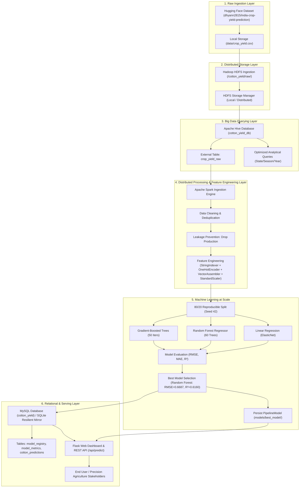

# End-to-End System Architecture

## Overview

The **Big Data Cotton Yield Prediction System** represents an enterprise-grade, distributed data engineering and machine learning platform. It automates the lifecycle of agricultural data from raw ingestion to real-time serving.

## Architectural Rationale

| Layer | Technology | Primary Role & Rationale |
| :--- | :--- | :--- |
| **Distributed Storage** | Hadoop HDFS | Provides fault-tolerant, horizontal data storage with multi-tiered directory abstraction (`raw/`, `processed/`, `features/`, `predictions/`). |
| **Data Warehousing** | Apache Hive | Enables declarative SQL-based querying and schema-on-read querying over raw datasets without driver memory pressure. |
| **Distributed Compute** | Apache Spark (PySpark) | In-memory distributed engine for parallel data transformation, feature scaling, and ETL processing across cluster partitions. |
| **Scalable ML** | Spark MLlib | Distributed machine learning pipelines that bundle preprocessing transformers and tree-based regressors into an exportable single pipeline artifact. |
| **Relational Storage** | MySQL / SQLite | Provides ACID relational persistence for model registry tracking, experiment evaluation metrics, and audit logs. |
| **Presentation & API**| Flask + HTML5/CSS3 | Decoupled lightweight web dashboard and JSON REST API for real-time model inference and agricultural monitoring. |
